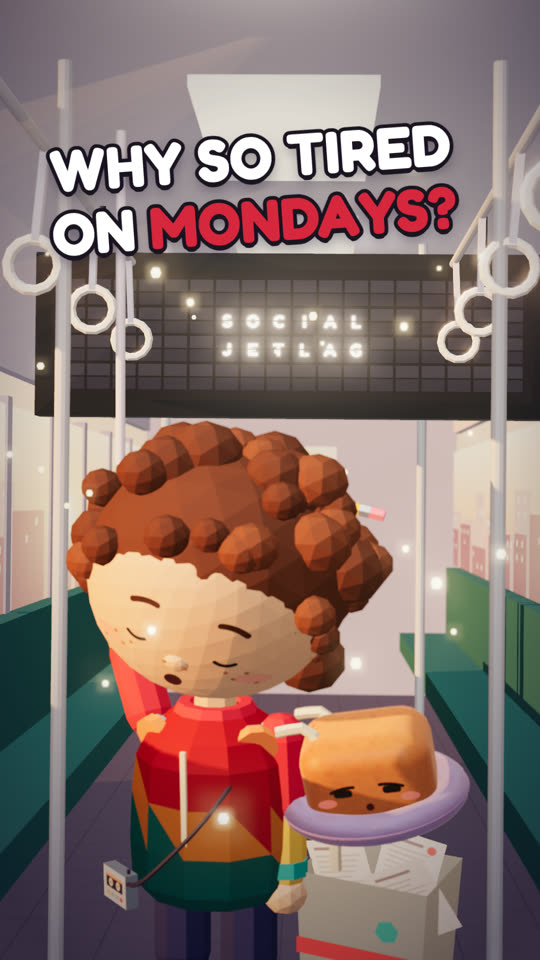
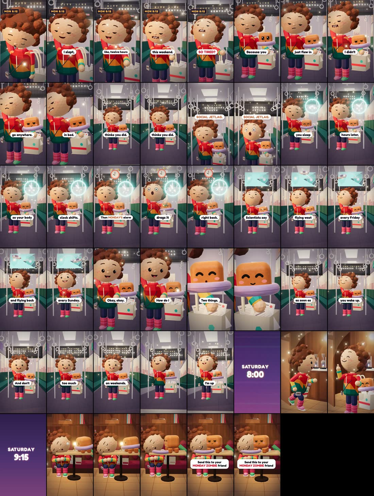

# once-upon-a-why-skill

A **Claude Code skill + Remotion kit** for making short vertical 3D cartoon explainer episodes
(1080 × 1920, 30 fps, 40–50 s) entirely in code, with **local voices** (no API keys), **word-timed captions**
and **original procedural sound**. Two heroines in their 20s, Mika and Nora, ask real-life "why" questions,
and Claude, a small felted-clay helper, explains.

<p>
  
  
</p>

*Episode 1, "Why am I so tired on Mondays?" (social jetlag): cover and one frame per second.*

> **New here? Follow [GETTING-STARTED.md](GETTING-STARTED.md).** It sets up the exact same studio (characters,
> locked voices at pinned model versions, workflow) step by step, checks your voices against the reference samples,
> and shows how to make your first episode with `/ouaw-episode` and the [episode brief template](docs/EPISODE-BRIEF-TEMPLATE.md).

## What's inside

| Path | What |
|---|---|
| `.claude/skills/ouaw-episode/SKILL.md` | the skill: makes one episode end to end, with 4 stops for your OK (voices → shot list → half-size draft → final + cover) |
| `series/onceuponawhy/BIBLE.md` | the series bible: look ("City Pop Dusk"), locked cast, 7 sets, voices, caption and safe-area rules, production lessons |
| `series/onceuponawhy/pronunciation.json` + `tools/pron.py` | pronunciation dictionary applied before every TTS call (Kokoro phonemes / plain respellings) |
| `series/onceuponawhy/voice-tests/` | the voice settings and generation code (`v2/make_takes.py`: `synth()`, pace guard, levelling), the voice tests |
| `src/series/onceuponawhy/` | the Remotion + three.js kit: stage and post chain, cast (Mika, Nora, Claude), sets, props, holograms, overlays (captions, title and time cards, VHS glitch) |
| `src/series/onceuponawhy/episodes/ouaw01/` | episode 1: scene logic (shots, cameras, performances, face-aware captions) and the composition |
| `episodes/ouaw-01-monday/` | episode 1 workflow scripts: `make_voice.py` (takes, picks, word timings), `make_timeline.py`, `make_sfx.py` (all SFX + music, procedural), `check_captions.ts` / `run_check.mjs` (caption check), `shotlist.md`, `voice/SETTINGS.md` |
| `render.sh` | renders, then two-pass loudness normalisation (−14 LUFS, −1.5 dBTP) and trims audio to the video |
| `CLAUDE.md` | the house rules Claude Code follows in this project |

Generated audio, renders and model weights are **not** in the repo (see `.gitignore`); the scripts rebuild them.

## Requirements

- A **Mac with Apple Silicon** (MLX runs the voice and transcription models locally). 8 GB RAM works; 16 GB is comfier.
- [Homebrew](https://brew.sh)
- **Node.js** 20+ and npm
- **ffmpeg 7+**
- **Python 3.12** with a virtual environment holding **mlx-audio** and **mlx-whisper** (`requirements.txt`)
- [Claude Code](https://claude.com/claude-code)

## Setup

```bash
brew install node ffmpeg python@3.12
```

```bash
git clone <this repo> once-upon-a-why-skill && cd once-upon-a-why-skill
```

```bash
npm ci
```

```bash
python3.12 -m venv .venv && .venv/bin/pip install -r requirements.txt
```

Check that everything compiles:

```bash
npx tsc --noEmit -p .
```

Open the studio to browse the compositions (episode, cover, character sheet, sets):

```bash
npx remotion studio
```

## Install the skill in Claude Code

The skill already sits in this project at `.claude/skills/ouaw-episode/`, so it is available whenever you run
Claude Code **inside this folder** (type `/ouaw-episode`). That is the recommended way, because the skill uses the
kit, scripts and bible in this repo.

To also have it in other projects, copy it to your user skills folder (it still expects this repo's files there):

```bash
mkdir -p ~/.claude/skills && cp -R .claude/skills/ouaw-episode ~/.claude/skills/
```

## Rebuild and render episode 1 (the worked example)

Voices (downloads the voice models on first run, then makes 3 takes per line, picks, levels and times them):

```bash
.venv/bin/python episodes/ouaw-01-monday/make_voice.py gen
```

```bash
.venv/bin/python episodes/ouaw-01-monday/make_voice.py pick && .venv/bin/python episodes/ouaw-01-monday/make_voice.py publish
```

Timeline, sound and the caption check:

```bash
python3 episodes/ouaw-01-monday/make_timeline.py && .venv/bin/python episodes/ouaw-01-monday/make_sfx.py
```

```bash
node episodes/ouaw-01-monday/run_check.mjs
```

Half-size draft, then the final and the cover:

```bash
CHUNK=150 REMOTION_ARGS="--scale=0.5 --gl=angle --concurrency=2" ./render.sh OUAW01Monday ouaw-01-monday-draft
```

```bash
CHUNK=150 REMOTION_ARGS="--gl=angle --concurrency=2" ./render.sh OUAW01Monday ouaw-01-monday
```

```bash
npx remotion still src/index.ts OUAW01Cover out/ouaw-01-monday-cover.png --gl=angle
```

Takes are sampled, so a rebuild sounds a little different from the original episode; the pickers re-run the same checks.

## Make your first episode

1. Open Claude Code in this folder and run `/ouaw-episode`.
2. Give it the question (title), the exact script lines per speaker, the target length, the locations and any new
   props, voice direction per line, accent words, the end text and the cover idea.
3. The skill works in 4 steps and stops for your OK after each one:
   **voices** (takes, pronunciation check, a preview wav and a settings table) → **shot list** (anchored to the word
   timings) → **half-size draft** (contact sheet + caption check) → **final render + cover**.

## Voice models (downloaded separately)

The models are **not included**. mlx-audio / mlx-whisper download them from Hugging Face on first use, **at the
exact revisions the series was made with** (pinned in `series/onceuponawhy/voice-tests/v2/make_takes.py`), and each
one comes under **its own licence**; check the model card before you publish anything made with them.
Three reference samples (one per character) are in the repo; `series/onceuponawhy/tools/voice_check.py` compares
your voices with them.

| Role | Model |
|---|---|
| Claude | Kokoro-82M (`prince-canuma/Kokoro-82M`), voice `am_echo` |
| Mika | Chatterbox Turbo (`mlx-community/chatterbox-turbo-fp16`), built-in voice |
| Nora | Qwen3-TTS VoiceDesign 1.7B (`mlx-community/Qwen3-TTS-12Hz-1.7B-VoiceDesign-bf16`), a designed voice |
| Word timings | Whisper small (`mlx-community/whisper-small-mlx`) |

No voice is cloned from a real person: only built-in or designed voices.

## Licences

- This repo: **MIT** (see `LICENSE`).
- **Remotion** has its own licence (free for individuals and small teams; some companies need a paid licence). See
  [remotion.dev/license](https://www.remotion.dev/license).
- Fonts (Yellowtail, Fredoka) load from Google Fonts through `@remotion/google-fonts`, under their own licences.
- Voice and transcription models: see above.
